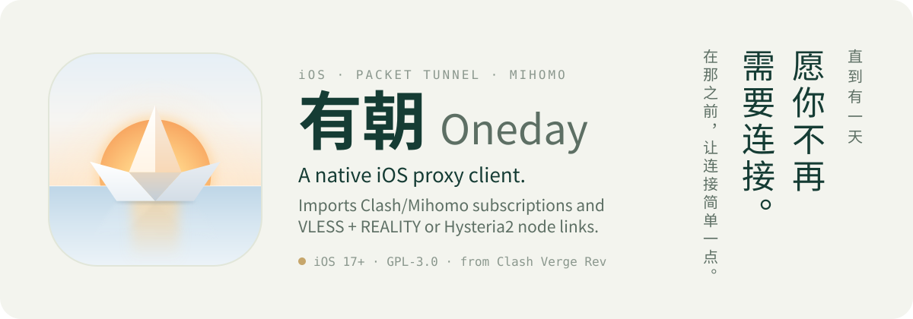

<p align="center">
  <picture>
    <source media="(prefers-color-scheme: dark)" srcset="./docs/readme/hero-dark.svg">
    
  </picture>
</p>

<p align="center">
  <strong>愿有朝一日，你不再需要这个 App。</strong><br>
  For a future where this app is no longer needed.<br>
  いつか、このアプリが必要なくなる日を願って。
</p>

<p align="center">
  <a href="https://github.com/sponsors/XKHoshizora">
    
  </a><br>
  <sub>支持有朝 · Help keep TestFlight builds signed and development going.</sub>
</p>

<p align="center">
  <a href="#what-it-does">Features</a> ·
  <a href="docs/ONEDAY-IOS.md">Build guide</a> ·
  <a href="#support-oneday">Support Oneday</a> ·
  <a href="docs/ONEDAY-UPSTREAM.md">Upstream and attribution</a> ·
  <a href="docs/ONEDAY-ICON.md">App icon</a> ·
  <a href="LICENSE">GPL-3.0</a>
</p>

> [!NOTE]
> Oneday is a personal prototype. Builds go to TestFlight internal testing only; it is not on the App Store.

## What it does

- **Subscriptions.** Import a Clash/Mihomo subscription over HTTPS or from a local YAML file. Each one becomes its own group of nodes and refreshes on its own.
- **Node links.** Paste `vless://` (VLESS + REALITY) and `hysteria2://` links, one or several at a time. They collect in the 「独立节点」 (independent nodes) group, and a pasted link whose name is already listed replaces that node.
- **Tidy up.** Swipe left to delete a single link node or a whole group, or clear every node from the bottom of the list. Deleting waits until you disconnect.
- **One switch.** Choose a node and connect. A Packet Tunnel extension runs mihomo with that node. While connected, the app shows live download and upload speed and how long you've been connected.
- **Follows the system.** The interface switches between light and dark with iOS.
- **Stays on the device.** Subscription URLs, credentials and runtime configuration are kept in the app's App Group storage. Subscriptions are fetched directly, without a third-party conversion service, and a subscription can't redirect the app to local or private network addresses.

## Support Oneday

Oneday is free and open source. Sponsorships pay the yearly Apple Developer Program fee that keeps TestFlight builds signed and coming, and the time that goes into keeping the project running.

**[Become a monthly sponsor](https://github.com/sponsors/XKHoshizora?frequency=recurring)** · **[Make a one-time contribution](https://github.com/sponsors/XKHoshizora?frequency=one-time)**

欢迎通过 GitHub Sponsors 支持有朝，帮助项目持续开发与维护。

## How it fits together

| Part | Path | Role |
| --- | --- | --- |
| Interface | [`mobile/`](mobile) | React UI in a WKWebView: import, parse, group and choose nodes |
| Host app | [`ios/App`](ios/App) | Swift host: fetches subscriptions, saves the profile, starts the tunnel |
| Tunnel | [`ios/PacketTunnel`](ios/PacketTunnel) | Network Extension that runs the mihomo core and reports traffic |
| Desktop base | [`src/`](src), [`src-tauri/`](src-tauri) | Clash Verge Rev v2.5.8, kept with its history |

## Build

You need macOS, Xcode 27 or newer, Node.js, pnpm 12 and XcodeGen. From the repository root:

```bash
bash scripts/ios-prepare.sh
```

This downloads the pinned, checksum-verified mihomo SDK, builds the interface and generates the Xcode project. For a device build, copy `ios/Signing.example.xcconfig` to `ios/Signing.local.xcconfig`, enter your Team ID, and build the `Oneday` scheme in Xcode.

The simulator covers the interface and subscription handling; VPN traffic needs a signed iPhone. Simulator commands, tests and signing details are in the [build guide](docs/ONEDAY-IOS.md).

## Current limits

- The selected node carries all traffic, with local networks direct. Rules, policy groups, scripts and geodata from desktop profiles are not imported.
- Subscriptions that only reference proxy providers, without an inline `proxies` list, are not supported yet.
- Node links are limited to `vless://` and `hysteria2://` (`hy2://`) for now; other link types in a paste are skipped with a notice.

## Built on Clash Verge Rev

Oneday is a fork of [Clash Verge Rev](https://github.com/clash-verge-rev/clash-verge-rev) v2.5.8. The desktop client's source and history remain in this repository, and its original introduction is kept in [README.upstream.md](README.upstream.md).

With thanks to:

- [clash-verge-rev/clash-verge-rev](https://github.com/clash-verge-rev/clash-verge-rev), the desktop base.
- [zzzgydi/clash-verge](https://github.com/zzzgydi/clash-verge), the original Clash Verge.
- [MetaCubeX/mihomo](https://github.com/MetaCubeX/mihomo), the proxy core.
- [ProjectClash/Clash](https://github.com/ProjectClash/Clash), the Apple mihomo SDK.
- [ProjectClash/Clash-Adapter](https://github.com/ProjectClash/Clash-Adapter), the packet-flow bridge.

Pinned versions, commits and checksums are listed in [ONEDAY-UPSTREAM.md](docs/ONEDAY-UPSTREAM.md).

## Star History

<a href="https://www.star-history.com/?repos=XKHoshizora%2FOneday&type=date&legend=top-left">
 <picture>
   <source media="(prefers-color-scheme: dark)" srcset="https://api.star-history.com/chart?repos=XKHoshizora/Oneday&type=date&theme=dark&legend=top-left" />
   <source media="(prefers-color-scheme: light)" srcset="https://api.star-history.com/chart?repos=XKHoshizora/Oneday&type=date&legend=top-left" />
   
 </picture>
</a>

## License

GPL-3.0-only, as a derivative of Clash Verge Rev. See [LICENSE](LICENSE). Component notices ship with the app in [`ios/App/Resources/Licenses`](ios/App/Resources/Licenses).
